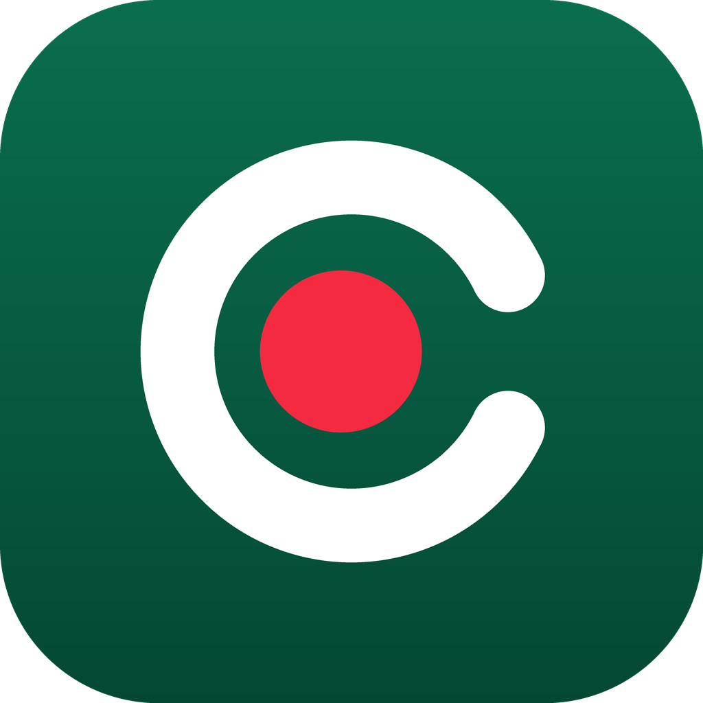

  

# CamVerse

Screen recording and editing for polished demo, tutorial and business videos, tuned to run well on low-spec PCs.

**Download:** [latest Windows installer](https://github.com/princeshiamofficial/garbanzo/releases/latest)

## What's in CamVerse

- **Ultra Lite mode** for 2–4 GB RAM PCs: lighter recording, preview and low-memory export ([LITE_MODE.md](LITE_MODE.md))
- **Teleprompter** that stays hidden from the recording ([TELEPROMPTER_ANC.md](TELEPROMPTER_ANC.md))
- **Noise cancellation (ANC)** for the microphone
- **Screen drawing** while recording: pen, arrow, box, highlighter, text ([SCREEN_DRAWING.md](SCREEN_DRAWING.md))
- Clear microphone capture, live level on the selected mic, and an **Accurate** cursor mode that follows the real mouse path and speed
- Everything from Recordly: auto-zoom, cursor effects, backgrounds, webcam bubble, timeline editing, captions

Recordings and exports stay on your PC. CamVerse has no account or cloud upload.

## Building

See [LITE_MODE.md](LITE_MODE.md#build-windows-installer). In short: run the **Build Electron App** workflow in GitHub Actions; it builds the installers and publishes them to a GitHub Release.

To sign the Windows installer (removes the "dangerous download" warnings), add the repository secrets `WIN_CSC_LINK` (base64 `.pfx` or URL) and `WIN_CSC_KEY_PASSWORD`.

## Credits and license

CamVerse is based on [Recordly](https://github.com/webadderallorg/Recordly) by webadderall and its contributors, and is distributed under the same **GNU AGPL-3.0** license ([LICENSE.md](LICENSE.md)). The full source code, including CamVerse's changes, is in this repository. Recordly's original README is kept in [README.recordly.md](README.recordly.md).
